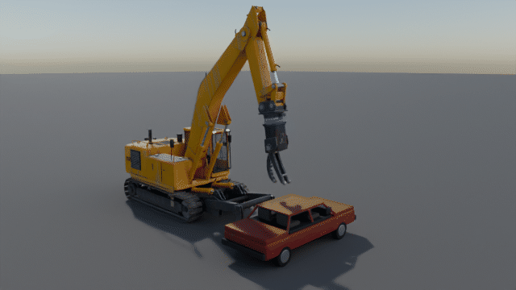
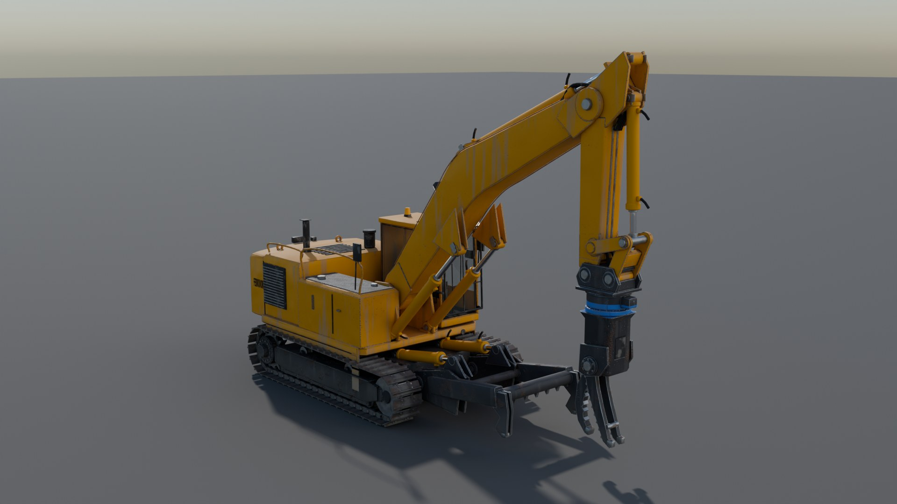
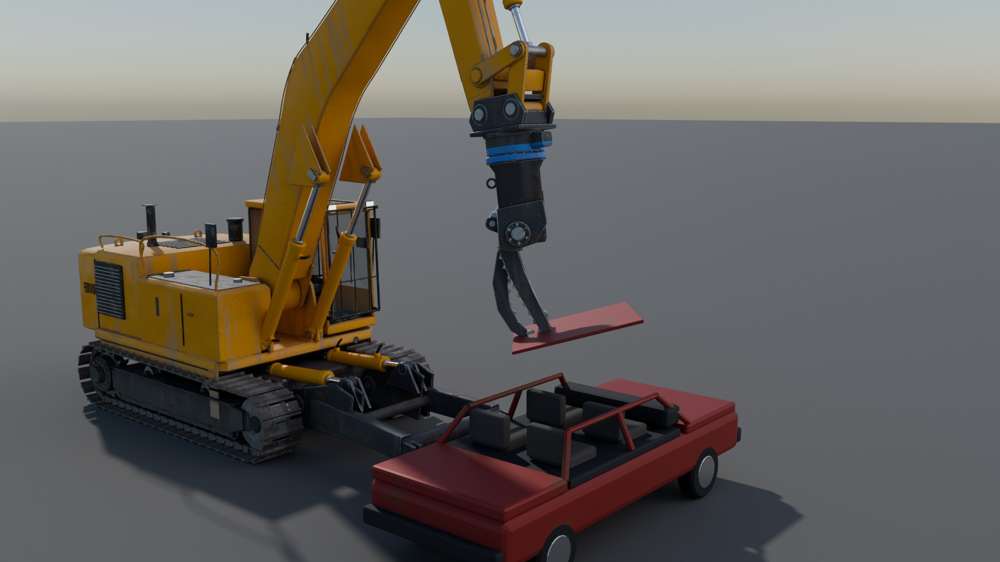
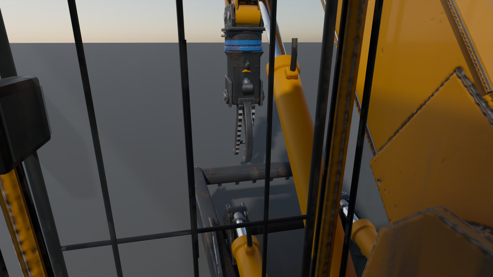
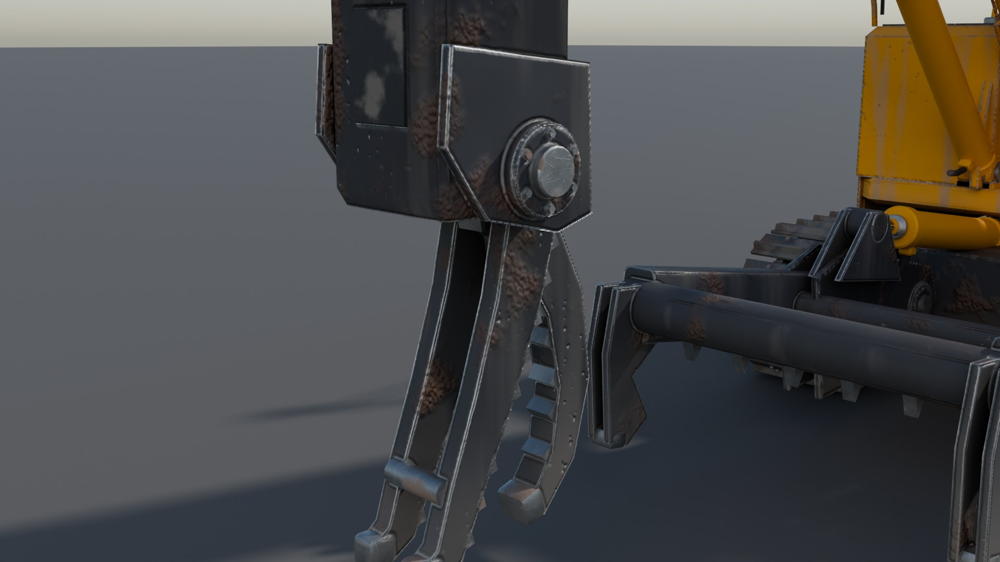
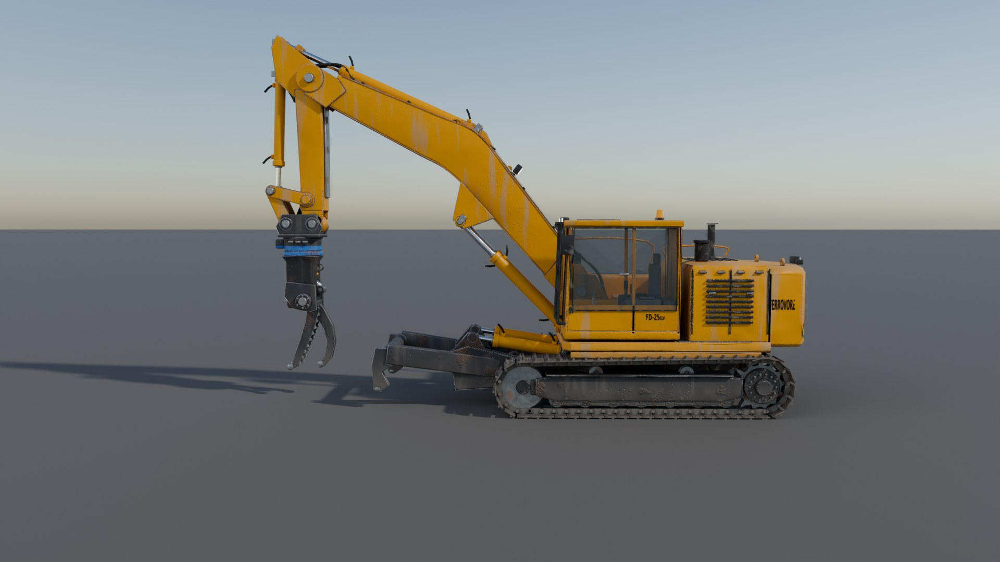
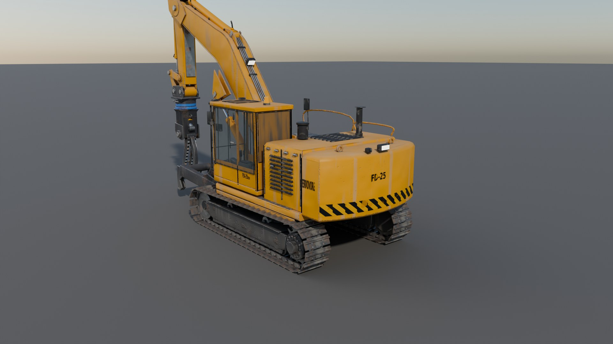

# Ferrovore FD-25 Car Dismantler — BeamNG.drive vehicle mod



The FD-25 is a drivable **25-tonne crawler excavator rigged for end-of-life-vehicle dismantling**, the
same kind of machine as in the "Crc MechLife" reel. It has:

* a **360° rotating dismantling shear** with a blue rotator ring, a forked fixed jaw and a hooked moving jaw;
* a **hydraulic clamp arm** on the front of the undercarriage that pins the car down while the shear tears it apart;
* a fully articulated **boom, stick and 4-bar tilt linkage**, an independent rotator, and slewing upper structure;
* **twin-track travel** with skid and pivot steering (3.0 / 5.5 km/h).

All seven hydraulic functions are real BeamNG hydros and torsion hydros, driven by a custom Lua
controller. It models valve-spool lag, a shared pump, auto-idle, end-of-stroke cushioning and relief valves
(including the squeal). It also has precision mode, power modes, claw level assist and auto poses.

| | |
|---|---|
|  |  |
|  |  |
|  |  |

_The renders are Cycles previews of the same meshes and textures that ship in the mod. The animation is
posed with the mod's own kinematic solver. The wrecked car only appears in the renders and is not part
of the mod._

## Install

1. Download **[`dist/ferrovore_fd25.zip`](dist/ferrovore_fd25.zip)**.
2. Drop the zip, without unpacking it, into `Documents/BeamNG.drive/<game version>/mods/`
   (on Linux/Proton: `~/.local/share/BeamNG.drive/<version>/mods/`).
3. Start the game and open the vehicle selector. **Ferrovore → FD-25 Car Dismantler**.
4. Optional: add the **FD-25 Hydraulics** UI app (UI Apps → Add app). It shows cylinder strokes, relief
   warnings, swing and rotator angles, pressure, flow and modes, and has quick buttons.

## Controls (defaults, all rebindable under *Options → Controls → Vehicle Specific*)

| | Keyboard | Gamepad |
|---|---|---|
| Swing left / right | ← / → | left stick X |
| Boom up / down | ↑ / ↓ | RT / LT |
| Stick in / out | K / I | left stick Y |
| Claw curl in / out | L / O | D-pad down / up |
| Rotate claw ⟲ / ⟳ | Y / U | LB / RB |
| Jaw close / open | G / T | A / B |
| Clamp arm down / up | . / , | D-pad right / left |
| Work ↔ Travel mode (arrows drive the tracks) | B | Y |
| Precision mode | Shift + B | X |
| Power mode / level assist / beacon | Shift + T / Shift + G / Shift + O | |
| Auto pose stow / work | Shift + Y / Shift + U | |
| Travel speed low ↔ high | Shift + K | |

Every function also has an **analog axis** action for joysticks. See **[docs/CONTROLS.md](docs/CONTROLS.md)**
for the full reference and an explanation of the hydraulics model.

## Configurations

| Config | Notes |
|---|---|
| **Car Dismantler** (default) | Standard cab, rotating shear, clamp arm, construction yellow |
| **Car Dismantler (Elevated Cab)** | Cab on a 0.95 m riser, safety orange |
| **Shear Only (No Clamp Arm)** | Clamp arm removed, weathered yellow |
| **Car Dismantler (Arcade Hydraulics)** | About twice as fast, recycling green |

Paints: Construction Yellow, Safety Orange, Industrial Grey, Recycling Green and Weathered Yellow. Any
colour works through the in-game paint picker. The yellow body uses a layered material (paint over primer
and bare steel, with chips and dirt), so the wear stays visible in every colour.

## What's inside

| | |
|---|---|
| Physics | 726 nodes and 4 232 beams in the default configuration, 7 hydros and 6 torsion hydros (swing and rotator), 8 hidden steel road wheels, two electric travel motors. ≈ 27.9 t. |
| Models | 45 hard-surface meshes (~100 k triangles): track shoes, sprockets and idlers that animate with travel; weld beads, bolts and hoses; cab interior; separate barrel and rod meshes for every cylinder. |
| Textures | Procedural PBR: 4K atlases for the upper structure, arm and attachment, 2K for the undercarriage, tiling detail maps, decals. BeamNG v1.5 layered materials. |
| Sounds | Synthesised diesel loop (follows rpm), relief-valve squeal, track clank, plus BeamNG's hydraulic pump and reverse-alarm events. |
| Lights | Work lights (headlight switch) and an amber beacon (Shift + O), with emissive glow materials. |
| Cameras | Operator's eye in the cab, a claw camera on the stick, and the orbit camera. |
| Tuning | Every speed, range and behaviour flag is in `fd25_hydraulics.jbeam`. Edit it and press Ctrl + R. |

Research on the real machine, with reference specs and sources:
**[docs/MACHINE_RESEARCH.md](docs/MACHINE_RESEARCH.md)**.

## Validation

BeamNG cannot run in the environment where this mod was built. Instead, the pipeline checks the mod
offline. See **[docs/VALIDATION.md](docs/VALIDATION.md)** for the full reports.

* **Static JBeam checks.** References, triangles, prop frames, mass and CoG, tipping, and the per-node
  stability budget at 2 kHz. A rigidity (rank) analysis proves that only the intended degrees of freedom
  remain.
* **Asset cross-check.** Every mesh, material, texture, sound, input action and configuration reference
  resolves. The Lua compiles under LuaJIT.
* **Controller unit tests.** The real Lua controller runs in LuaJIT against an ideal hydraulic plant.
* **Physics co-simulation.** A numpy soft-body solver at 2 kHz runs the generated JBeam with the real Lua
  controller. It covers settling, every hydraulic function, relief, swing, rotator, auto poses, level
  assist, straight travel, pivot turns and brakes.

**Latest results:**
* Rigidity: 14 DOF, exactly as expected.
* Every node is inside the 2 kHz stability budget.
* Asset cross-check: 0 errors.
* Controller unit tests: 31/31 pass.
* Co-simulation: all 18 scenarios pass.

Co-simulation highlights:
* Claw level assist holds the claw within 1.3° while the stick swings 55°.
* Relief valves stall at 519 kN against a 516 kN setting.
* Straight travel drifts 1 cm over 5.5 m.

The one warning is a tipping margin of 0.11 m with 1.5 t in the claw at full reach over the side,
which is as marginal as on a real 25 t excavator.

## Building from source

Everything is generated from code in `tools/`, and `tools/spec/machine.py` is the single source of truth.
You need Python 3.11, plus the packages `bpy==4.5.*`, `numpy`, `scipy`, `pillow`, `soundfile` and `lupa`.

```bash
python -m tools.build_all            # full pipeline (bake + renders take ~25 min on 4 CPU cores)
python -m tools.build_all --skip-bake --skip-renders --skip-cosim   # quick rebuild
```

## Known limitations

* **Not play-tested inside BeamNG.drive.** The engine APIs used were checked against BeamNG's shipped
  vehicle Lua and the official docs, and the whole machine was co-simulated. Still, expect that a few
  values may want tuning in game: speeds, stiffness, camera positions. Every such value is a jbeam
  parameter, so no rebuild is needed.
* **Swing and rotator range is ±170° (340°)** rather than continuous rotation, which keeps the physics
  robust. Every orientation is still reachable.
* **The tracks are hidden steel road wheels** with animated track visuals, not simulated track chains.
* The brand and model are fictional.
